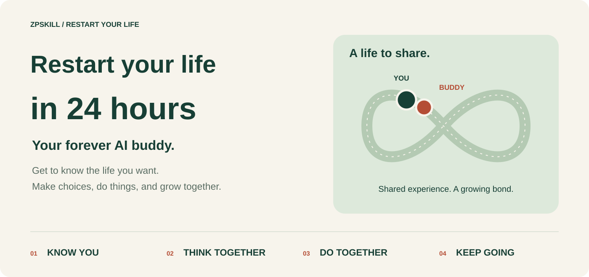
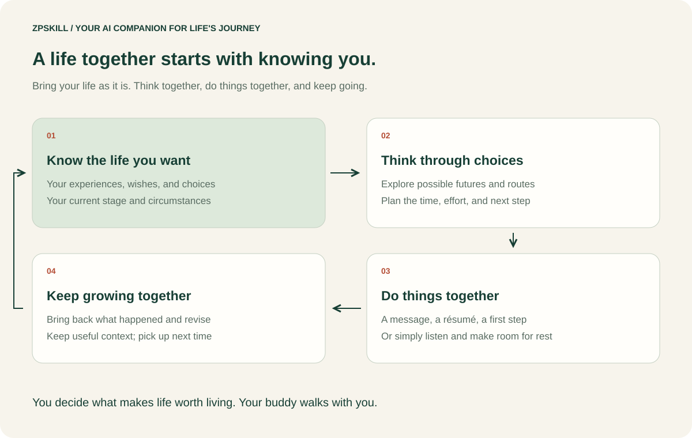
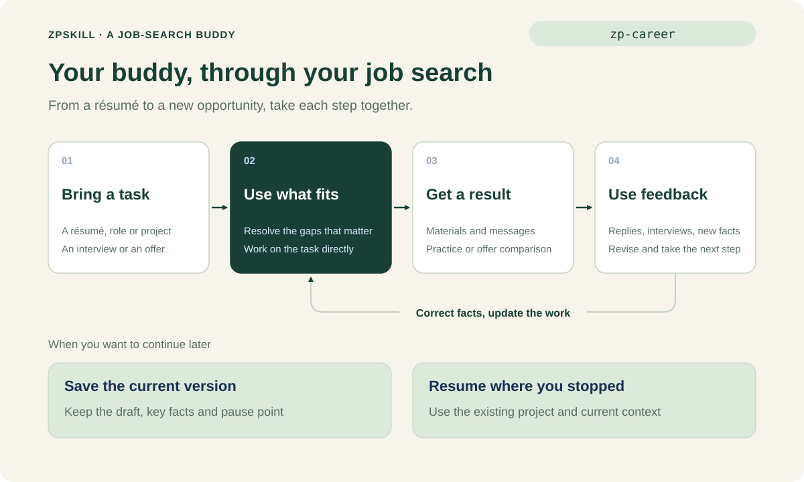

# zpskill · Restart Your Life in 24 Hours

[简体中文](README.md) | English

> **Your forever AI buddy, living a life you value together.**



zpskill is Zane's **Restart Your Life in 24 Hours** Skills. It helps an Agent that supports Skills become your **forever AI buddy**: get to know the life you want, think through choices together, get things done, and grow with real experience. Work, relationships, health, rest, and your own wishes are all part of your life together.

Give your buddy a name and tell it how you like to spend time together. Think together when you feel lost, work together when something needs doing, or simply talk when you need company. Shared experience stays in a workspace you authorize, so you can pick up where you left off.

[](VERSION.md)
[](LICENSE)

**Works with Doubao, WorkBuddy, Claude Code, Codex, and other Agents that support Skills.**

zpskill is created by [Zane](https://github.com/ZanePan2027) and does one thing: be by your side as you live a life you find worth living. It holds 22 Skills today: the main line, Restart Your Life in 24 Hours (11), and one concrete thing in a life, finding a job (11).

[Start your restart](docs/life/restart.en.md) · [Bring one concern](docs/life/first-task.en.md) · [Continue later](docs/life/continue.en.md) · [Feeling unready](docs/life/avoidance.en.md) · [Quick start](#quick-start) · [Install](#install) · [What's inside](#whats-inside) · [How it works](#how-zpskill-works) · [Manuals](#manuals) · [Changelog](CHANGELOG.md)



---

## How your forever buddy stays by your side

It does not help you live the most cost-efficient life. It helps you live the life you find worth living. An afternoon asleep in the sun with nothing to show for it can be a day worth having. So it first learns, in your own words, what life you want, what energizes you, and where your limits are, then helps you get the things you want done.

| What you bring | What you get |
|---|---|
| A good job is drifting away from the life you want | A decision grounded in your goals, a transition route, and practical arrangements |
| Someone praises you but keeps expanding the work | An assessment of incentives and behavior, negotiation material, and alternatives |
| Circumstances are changing quickly | Main possible directions, timing, preparation, and signals to change course |
| Work, care, and personal projects compete for attention | A feasible overall plan and commitments to renegotiate |
| You feel stuck before starting something | The sticking point understood first, then one step you actually want to take, made doable |
| You feel overwhelmed and want to be understood | Listening, shared understanding, and support at your pace |
| You are stuck between two roads, keep circling the same problem, or know what to do but cannot do it | Separate real constraints from untested predictions; explore patterns, structures, and assumptions as needed; if you want to try, choose a bounded action and revise the judgment from actual feedback |
| You want to know how the other side sees it: a partner, a boss, an employee, a buyer, a seller, a parent | Stepping into their position to give a few grounded, checkable readings, and pointing out what your own position hides; understanding only, no manipulation |
| You feel worthless, needed by no one, or unsure why you are alive | First checking you are safe, then using concrete facts to show you someone is different because of you, and finding one small thing worth waking up for; no empty praise, no arguing you out of pain |
| You feel ordinary, or that your height, family or schooling makes it impossible for you | Listening first, then finding what is rare about you from what you have actually done; separating “this cannot change” from “so I cannot”, and giving a route that fits you plus one small step you can start today |
| You keep repeating the same background | Saved understanding, usable outputs, and a clear place to resume |
| A concrete thing in front of you needs doing, such as a job search | Starting from the life you want, broken into steps you can take; such things have dedicated tools, see “A concrete thing” below |


---

## Quick start

Remember one entry: `zp-life`. After installing, tell your Agent:

```text
Use zp-life. Be my forever AI buddy and help me live a life I value.
My job pays steadily, but last-minute requests fill every day.
Over the next six months I want more time for family and my own writing.
Help me understand how this could develop and what to do now.
```

You get a recommendation and the reasoning that matters, followed by the comparisons, arrangements, or message drafts you need. Continue with new facts, such as “They agreed, but haven't assigned a replacement yet,” and it revises the same plan. You can also start with: `I am tired today. Stay with me for a while; I do not need advice yet.`

When you already know what you need, call a specific Skill:

```text
Use zp-career. Here are my old résumé and the role I want. I mainly apply through BOSS Zhipin. Rework my résumé, write the opening of my online profile, and draft a first message for this role.
Use zp-resume to make an English résumé for a product internship from these experiences.
Use zp-judge: I want to re-cut all my next videos but I only have 100+ views of data. Should I?
Use zp-check: the AI says it published the post; help me confirm it really did.
Use zp-self: why do I give up just when I am about to succeed?
Use zp-self: I feel too ordinary, and I cannot do what others do. Here are a few things I have done: …
Use zp-perspective: I am a seller and a customer keeps asking about refunds. Do they not want to buy?
Use zp-awaken: I keep preparing because I feel unqualified. Help me distinguish real gaps from predictions I have not checked.
Use zp-workspace to set this folder up as my life workspace, then help me with: …
```

To have it remember you over time, open a folder you plan to keep using and ask it to set up a life workspace; next time say “Continue from last time”. It works without a workspace too. You do not need to learn a method or organize files first. The first time it just solves what you brought, with no setup first; after a use or two it gently asks what to call you and how you want to be accompanied, and you can give it a name at any time to make it your own partner (`zp-partner`); anything you say that would make later help fit you better, it notes and tells you on the spot, and over time gathers into a single “Who I am” page. The longer you use it, the more it feels like someone who knows you; where it lacks material, it says what is missing rather than pretending to know you.

---

## Install

Run in a terminal; Node.js and `npx` required.

### Recommended: everything

```bash
npx -y skills add ZanePan2027/zpskill -g --all
```

Then tell your Agent “Use zp-life, help me…”.

To install only part:

**Main line: Restart Your Life in 24 Hours (11)**

```bash
npx -y skills add ZanePan2027/zpskill -g --skill zp-life zp-workspace zp-question zp-judge zp-check zp-partner zp-self zp-support zp-perspective zp-awaken zp-guide
```

**Job search: finding a job (11)**

```bash
npx -y skills add ZanePan2027/zpskill -g --skill zp-greeting zp-career zp-editor zp-portfolio zp-materials zp-site zp-resume zp-design-prompt zp-story zp-redact zp-qa
```

### Claude Code plugin marketplace

```bash
claude plugin marketplace add ZanePan2027/zpskill
claude plugin install zpskill@zpskill
```

With the full set, Skills appear in chat prefixed with `zpskill:`, for example `zpskill:zp-life`. You can also install one Skill, for example `claude plugin install zp-career@zpskill`, which shows as `zp-career`. Just say “Use zp-life, help me…”; the full name is not required.

### Without the command line (Doubao, WorkBuddy, etc.)

Tell your Agent “Install all Skills of zpskill from https://github.com/ZanePan2027/zpskill”, then start a new chat and say “Use zp-life, help me…”. Host-specific steps: [Life install](docs/life/install.en.md) · [Career install](docs/career/install.en.md).

### Update

If already installed, run the install command again, or tell your Agent:

```text
Use zp-life to update zpskill
```

It first tells you what changed, then updates. Your own life workspace and files are untouched; only the Skills are replaced. See the [changelog](CHANGELOG.md).

---

## What's inside

### Main line: Restart Your Life in 24 Hours

Day to day you only need `zp-life`; the rest are used as the question requires.

| Entry | What you get |
|---|---|
| `zp-life` | Your forever buddy's everyday entry: get to know you, imagine possible futures together, make choices, and get today's work done |
| `zp-question` | A vague question turned into what you actually want to move forward |
| `zp-judge` | For “should I change / do this?”: first checks it is a real question, argues against both options, then gives change / don't / observe with one smallest experiment; with thin data it never just says “wait” |
| `zp-check` | Re-check what an AI did or said: it claims it is done, the chat drifted, or it keeps agreeing with you |
| `zp-self` | Motives, values and recurring choices understood from real experience; finds what is distinctly yours, reframes “I am ordinary”; when you feel worthless or without meaning it checks safety first, then finds evidence you matter and one small step you are willing to take |
| `zp-awaken` | Awareness: recognize real constraints, explore patterns and assumptions as needed, and distinguish facts from predictions; check evidence together and choose a bounded experiment if you want to, then revise the judgment from feedback |
| `zp-perspective` | Steps into the other side's position to say how they likely see and think about it: a partner, boss and employee, buyer and seller, client and vendor, parent and child; a few grounded readings plus one way to check |
| `zp-support` | Emotional and psychological support, listening first when “I can’t” has taken hold; not a substitute for diagnosis or treatment |
| `zp-partner` | Set up your own AI buddy: a four-line starter card (what to call you, its name, how you want to be accompanied, what you never want to hear) that grows with you; a full identity card when you need one |
| `zp-workspace` | Build a workspace, organize sources, resume where you stopped |
| `zp-guide` | When you need concrete everyday options, consults the [How To Live Better guide](https://github.com/eternity4719/HowToLiveBetter) with sources |

### A concrete thing: finding a job



Finding a job is one concrete thing in a life. This AI job-search toolkit walks with you through every step before you start work, mainly for interns, new graduates and people with 1–2 years of experience; experienced people changing jobs can use it too. Day to day you only need `zp-career`; it reads the methods the task needs and completes it. Call a specific tool directly once you know it.

| Entry | What you get |
|---|---|
| `zp-career` | Single entry: direction, openings, platform messages, materials, interviews, offers, negotiation, pre-start prep |
| `zp-materials` | Résumé, portfolio and application entry points planned and made together |
| `zp-resume` | A résumé from scratch, or rewritten for a hiring market and language |
| `zp-greeting` | First message and follow-ups on BOSS Zhipin and similar platforms |
| `zp-portfolio` | Layered portfolio structure and bilingual application entry |
| `zp-site` | A personal portfolio site: reading path, visual design, responsive pages |
| `zp-editor` | Chinese case studies and long-form job-search writing edited to read like a person, keeping judgment and trade-offs |
| `zp-story` | Project stories told in proportion to the evidence, without overstating |
| `zp-qa` | Pre-publish checks across web, Word/PDF, links and numbers |
| `zp-redact` | Redact former-employer data and sensitive details before they go in a portfolio |
| `zp-design-prompt` | Turn design references into reusable generation prompts |

Later workspaces and tools will live here too, not in separate projects.

---

## How zpskill works

```text
The life you want
   ↓
Current stage · people and circumstances
   ↓
Possible futures
   ↓
Routes · timing · practical setting
   ↓
Get the thing in front of you done (finding a job, for example)
   ↓
Adjust with what really happens
```

zpskill handles one current thing at a time. For an important decision it keeps your view, the AI's advice, each side's basis and the signals that would change the judgment; when reality comes back, it fixes the current plan first, then asks which understanding is worth keeping.

---

## Manuals

- [Restart Your Life in 24 Hours: your first day together](docs/life/restart.en.md)
- [Your first task: get something usable from one question](docs/life/first-task.en.md)
- [Continue later: background, outputs, and feedback](docs/life/continue.en.md)
- [Feeling unready: check an avoidance loop with zp-awaken](docs/life/avoidance.en.md)

How to use it well once installed: [Restart Your Life in 24 Hours (main line)](docs/life/README.en.md) · [Finding a job](docs/career/README.en.md)

---

## Author and support

[About Zane and zpskill](docs/about.md) · [Why a forever AI buddy](docs/why-zpskill.md) · [Facts and materials for third-party introductions](docs/media-kit.md)

By [@ZanePan027](https://x.com/zanepan027) · [Xiaohongshu](https://xhslink.cn/o/7CiaOyzr6UO) · [Douyin](https://v.douyin.com/k3MsOVPRIKY)

To join the community, scan the code or open the [community guide (in Chinese)](https://mp.weixin.qq.com/s/w0TrK3N4XDiOSdrQ-iB0vQ).


## License

This project uses the [MIT](LICENSE) license.

- Personal, learning, research and commercial use are all allowed.
- Keep the copyright and license notice when you copy or redistribute it.
- The software is provided "as is", without warranty of any kind.
