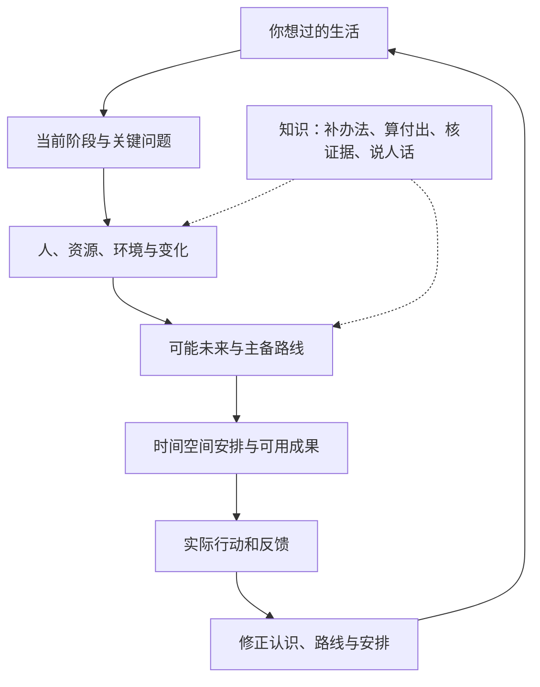
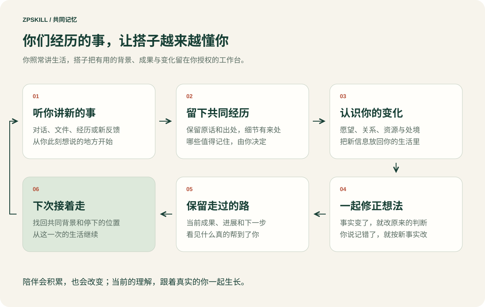

# 你的工作台怎样生长

[English](architecture.en.md) · [手册目录](README.md)

从当前问题开始，逐渐把有用信息接成一张能帮助选择的地图。沿你想过的生活判断阶段，理解人和局势，谋划可能未来，把路线变成当下成果。知识帮助发现遗漏办法、算清实际付出、核对关键证据，并翻成能用的行动。

## 文件怎样归拢

在你选择的文件夹里，从导航、资料入口和当前事项开始。随着需要，方向、个人底图、局势、路线和成果逐渐形成；AI沿实际目录归拢。

| 位置 | 帮你保留什么 |
|---|---|
| 方向 | 想过的生活、当前阶段与取舍 |
| 本人 | 本人原话、经历、偏好和相关生活领域 |
| 处境 | 人物、资源、环境、可能走向和经验 |
| 知识 | 可复用方法、适用条件、反例和来源 |
| 决策 | 当前主路、备路与换路信号 |
| 行动 | 实际进展、反馈、下一步及成品入口 |
| 资产 | 原始材料和可直接使用的成果 |
| 系统 | AI伙伴如何配合、保存与接续 |
| 收件箱 | 新材料进入的位置 |

第一次只建立当前问题需要的部分，之后随真实生活生长。你提供材料和反馈，AI负责把它们连回同一件事、当前路线与成果。

## 一条新信息怎样产生作用

你说“对方已安排了接手人”，AI会保留这条反馈，更新人物判断和合作路线，把新的下一步写回同一事项。你说“我的目标变了”，它会重新比较相关投入，修改当前阶段、路线和成果。

当前理解能回到原话与原件，历史保留当时为什么那样想。新会话从当前入口读取，继续真实暂停点。跨事项有用的经验会提炼成下次能采用的方法。

## 认识你，从一个问题开始长

你不用先填资料，第一次只带一个问题就够。AI 会问一次怎么称呼你、想怎样被陪，之后每次回应都用这个称呼和口吻。你说过的话里，凡是会让之后的帮助更合身的（想要什么、怕什么、不能碰什么、做成过什么），它记成一条并当场告诉你；你说它记错了，以你新的说法为准。积累到一定程度，它会提议把零散的话合成一页「我是谁」，给你看过再定稿。

从第一次对话起，它就认真陪你；随着共同经历积累，它会越来越理解你；没有材料的地方，它直说缺什么，不假装已经认识你。

## 让共同经历改善下一次帮助

重要决定可以分别留下你的看法与AI的建议，以及各自依据和会改变判断的反馈。结果回来后，AI先核实际发生与条件变化，再修正同一份方案；它自己的误判也会进入修正。

遇到相似选择时，工作台会对照旧经历与现在的不同，查看反例、成功条件和已经发生的成长。你继续自然地讲情况，AI负责归拢。倾诉、休息和体验仍可直接成为本次帮助的全部。

## AI怎样配合

一个主持者连续承接你的问题，按需要获得调查、制作或整理方面的帮助。每次协作有明确问题和交付，最终回到同一份方案与进展。长期伙伴可以设置独特的判断侧重与口吻。

你只需要讲情况、表达取舍、带回现实变化。AI负责资料归拢、方案制作和记录维护。
